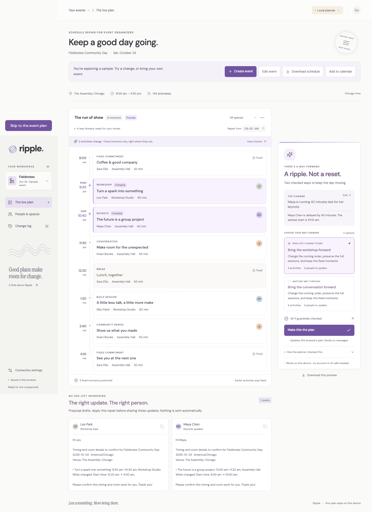

# Ripple

**Keep the day moving.** Constraint-checked schedule repair for people running community events.

[Open Ripple](https://aaravsinhaofficial.github.io/ripple/) · [Live AI setup](docs/deployment.md) · [Hackathon submission](docs/submission.md) · [MIT license](LICENSE)

[](https://github.com/aaravsinhaofficial/ripple/actions/workflows/ci.yml)

A speaker is late. A room goes offline. The opening session runs long. A small change becomes six conversations and a broken schedule.

Ripple turns that disruption into a repair you can inspect: what moves, what stays fixed, which constraints pass, and who needs a handoff. You choose a repair before it becomes the new local plan. Messages are prepared as drafts for your review.



## Project status

The public GitHub Pages app includes a **working local planner for your own events**, alongside a clearly identified fictional sample. Create an event in the built-in editor, select an exact activity or room, compare checked repairs, and approve a change. Download the current schedule, calendar file, or contextual handoff drafts. No account or JSON editing is required.

The local planner uses deterministic scheduling rules, not an AI model. The repository also contains the NVIDIA Nemotron / Nebius Token Factory service and optional Tavily search integration. **Live provider calls and Nebius Cloud deployment still require accounts, credentials, and runtime verification.** This is not yet a completed hackathon submission.

No API keys belong in the frontend or this repository. GitHub Pages hosts static assets; the live service is deployed separately.

## Run the app

Use Node.js 22.16 or later.

```sh
npm ci
npm run dev
```

Open the local URL printed by Vite. Try a disruption, inspect the alternatives, apply a repair, and export the handoffs. Use the app's connection settings to point it at a separately running backend.

Choose **Create event** to enter your day and agenda, then use **Choose a change** for a delay, room closure, or extra session time. **Edit event** changes the underlying commitments. See [Bring your own event](docs/event-format.md) for the everyday workflow and optional JSON import.

```sh
npm test
npm run build
npm run preview
```

Backend installation, credentials, allowed origins, and Nebius deployment are covered in [the deployment guide](docs/deployment.md). [Free-credit setup](docs/resources.md) includes the official hackathon offers.

## How it works

1. **Choose or interpret:** The guided form identifies the exact activity/room and change. In connected live mode, Nemotron Nano interprets freeform prose; guided inputs skip that unnecessary model call.
2. **Propose:** Nemotron Super proposes schedule repairs. Ultra is reserved for difficult cases that fail validation.
3. **Check:** Deterministic code checks identities, durations, locked sessions, rooms, people, capacity, buffers, and the event boundary. The repair-from time protects activities that have begun. An unlocked ongoing activity can be extended while preserving its start, room, and owner. Completed activities stay fixed. Invalid plans are never presented as feasible.
4. **Compare:** See changes and tradeoffs before applying the lowest-disruption option among those evaluated. We do not claim global optimality.
5. **Handoff:** Prepare targeted action cards. Applying a repair updates the local schedule; it does not send messages.
6. **Find resources when relevant:** Tavily can discover resource-replacement leads. Search results are evidence to review, not confirmed availability.

The local planner uses the confirmed form fields or a browser-local text parser, then bounded schedule search. Both operating modes are visible. A failed live request is surfaced as an error, rather than silently replaced with rule-based output.

Plans, up to six recent events, and each event's latest 12 repairs stay in browser storage. They are not synced between devices. Export event JSON for a reusable backup. Storage failures are shown visibly while the open plan remains downloadable.

## Technology

| Component | Role |
| --- | --- |
| React + TypeScript + Vite | Static, responsive event workspace on GitHub Pages |
| NVIDIA Nemotron Nano / Super / Ultra | Structured interpretation, repair proposals, difficult-case escalation |
| Nebius Token Factory | OpenAI-compatible runtime inference for the NVIDIA models |
| Python + FastAPI | Server-side orchestration, validation, and protected provider credentials |
| Tavily | Optional, source-linked resource discovery |
| Nebius Serverless Endpoints | Documented deployment path for the live API |
| Nebius Serverless Jobs | Documented deployment path for asynchronous processing |

See [platform notes](docs/platform-research.md) for sourced model and infrastructure details. Cloud deployment templates are prepared; they are not evidence of deployment.

## For judges and contributors

- [Submission draft and honest implementation status](docs/submission.md)
- [Under-three-minute demo script](docs/demo-script.md)
- [Rules, checklist, and evaluation gates](docs/hackathon.md)
- [Account setup and credit resources](docs/resources.md)
- [Deployment instructions](docs/deployment.md)
- [Validation scope and reproducible checks](docs/validation.md)
- [Five-case live evaluation command](docs/live-evaluation.md)
- [Provider feedback log](docs/feedback.md)

The project was started for the 2026 Nebius × NVIDIA Global AI Hackathon, Best Apps and Agents track. Its particular focus is **constraint-checked plan repair with visible tradeoffs and targeted handoffs**. It does not claim to be the first event AI tool.

## License

MIT. See [LICENSE](LICENSE). Model and service usage remains subject to the providers' terms.
