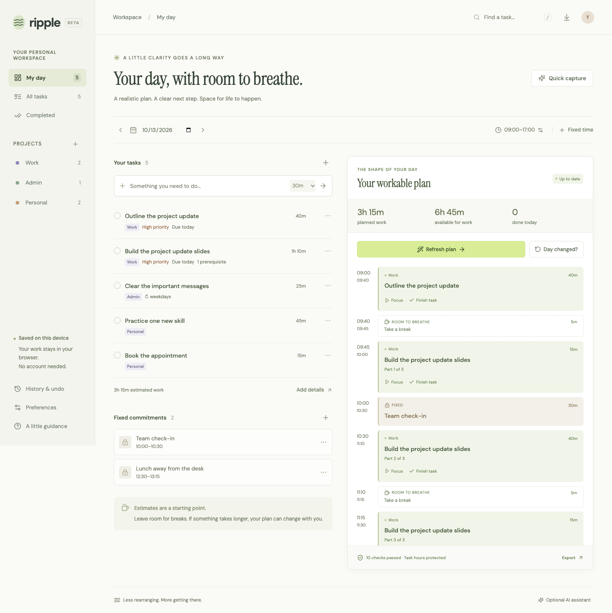

# Ripple

**Make today workable.** A daily planner that keeps unfinished work visible when the day changes.

[Open Ripple](https://aaravsinhaofficial.github.io/ripple/) · [Product guide](docs/product.md) · [Live service setup](docs/deployment.md) · [Submission draft](docs/submission.md) · [MIT license](LICENSE)

[](https://github.com/aaravsinhaofficial/ripple/actions/workflows/ci.yml)

You planned to finish a draft, answer a client, and prepare for a meeting. Then an interruption took an hour. Moving everything later hides the problem: some work no longer fits before you need to stop.

Ripple turns your tasks and fixed commitments into a day you can review. When time disappears, a task grows, urgent work arrives, or you need to finish earlier, it proposes a revised plan and shows what changed. Every estimated task minute is either scheduled or listed as unfinished work. Your stop time remains a boundary.



## Try it in two minutes

1. Add a task and its estimated remaining minutes, or open **Quick capture** and paste one task per line.
2. Set your working hours in **Preferences** and add any fixed commitments. Choose **Plan my day**, review the schedule and overflow, then apply it.
3. Choose **Day changed?** to recover from an interruption. Review the revised times and work that does not fit before applying the change.

You can start with the sample day or your own empty workspace. There is no account, subscription, or payment flow.

Example for the local Quick capture form:

```text
Draft the project update 45m #Work !high due:today
Reply to the client 20m #Admin
Practice a new skill 30m #Personal ~weekdays
```

Review the estimates before adding the drafts. Missing estimates start at 30 minutes. Use task details for deadlines, dependencies, notes, and recurrence.

## What works

| Everyday use | More control when needed |
| --- | --- |
| Quick task entry and reviewed multiline capture | Projects, search, priorities, dates and time deadlines |
| Time blocks around fixed commitments | Prerequisites, optional task splitting, focus and break lengths |
| Four guided ways to recover a changed day | Before/after review, explicit overflow and independent checks |
| Focus timer and manual completion | Daily, weekday and weekly repeats created on completion |
| Saved workspace on this device | Recent history, undo, validated backup and restore |
| Portable day plan | Text and timezone-aware ICS downloads; no automatic calendar sync |

Tasks carry forward until you finish or delete them. A timer ending or a time block passing never marks work done. For partially finished work, update the remaining estimate before replanning. Browser storage is not device sync; download a backup to keep a portable copy.

## Optional AI assistance

The core planner runs in the browser with deterministic rules. Connect a private Ripple service when you want help turning a messy note into task drafts or finding a way to start a difficult task.

- **Capture:** NVIDIA Nemotron Nano extracts task drafts through Nebius Token Factory. Review the titles, estimates, dates and dependencies before adding them.
- **Break down a task:** Nemotron Super proposes a short starting brief with concrete steps. Save it to task notes or download it after review.
- **Find useful sources:** An explicit research action makes one basic Tavily search, then Super creates source-linked steps. Cited URLs must match retrieved results. Citation matching verifies source identity, not the truth of every claim.

Provider credentials stay on the server. The daily workspace keeps the service URL and app access token in memory, clearing them on reload. Task text is sent only for a requested assistance action. Search receives the selected task title or research query, not the entire workspace or private task notes. Live failures remain visible; they are not replaced with a local answer.

**Status:** the daily MVP is published on GitHub Pages. Real Nano capture and Super task briefs ran through Nebius Token Factory on October 13, 2026, including the browser → authenticated local API → provider flow. The public site currently runs the local planner; hosted AI access, Tavily runtime and the final public video remain pending. See the [live findings](docs/feedback.md) and [submission evidence checklist](docs/submission.md).

## Run locally

Use Node.js 22.16 or later:

```sh
npm ci
npm run dev
```

Open the URL printed by Vite. The frontend needs no backend for task entry, planning, recovery, focus, history or exports.

For optional assistance, use Python 3.12 or later:

```sh
python3.12 -m venv .venv
.venv/bin/python -m pip install -r server/requirements.txt
cp .env.example .env
.venv/bin/python -m uvicorn server.app:app --host 127.0.0.1 --port 8000
```

The default `RIPPLE_MODE=demo` service makes rule-based drafts and checklists with zero provider calls. Connect `http://127.0.0.1:8000` from the app's assistance settings. For real inference, set `RIPPLE_MODE=live`, `NEBIUS_API_KEY`, and `RIPPLE_ACCESS_TOKEN` privately on the server. Optional web research also needs `RIPPLE_ENABLE_TAVILY=true` and `TAVILY_API_KEY`. Restart after changing configuration. The [daily evaluation command](docs/daily-live-evaluation.md) prepares zero-call fixtures by default and can run one explicitly selected live case. Never put provider keys in `VITE_*`, frontend code or browser storage.

The same FastAPI service hosts `POST /api/daily/assist` and the earlier event API. See [the product guide](docs/product.md#daily-assistance-api) for the daily contract and [deployment instructions](docs/deployment.md) for origins, credentials, limits and infrastructure. The deployment guide's repair queue and Ultra escalation concern the retained event workspace; daily assistance uses one synchronous, bounded request.

## How the day stays consistent

The planner compares three deterministic scheduling orders. Independent checks preserve fixed commitments, prevent task overlaps, enforce working hours and same-day time deadlines, order prerequisites, respect splitting and breaks, and account for all remaining task minutes. It does not claim the mathematically optimal plan or minimum possible change.

If work cannot fit, Ripple shows the unplaced minutes and the reason. Existing overlapping fixed commitments are preserved and reported for you to resolve. Overdue dates remain visible. No estimate is silently shortened, and no missed deadline is silently moved.

## Verify

```sh
npm test
.venv/bin/python -m pytest server/tests -q
npm run test:contracts
npx playwright install chromium
npm run test:e2e
npm run build
```

Daily tests cover scheduling and task-accounting invariants, storage, capture and exports. Backend assistance tests exercise bounded model routing, strict schemas, dates, dependency cycles, grounded links, authentication, limits and explicit failure behavior with mocks. The cross-runtime suite covers the earlier event engine. Re-run on the revision being submitted; historical event-workspace counts in [the validation record](docs/validation.md) are not daily-product evidence.

## Project context

Ripple began as a single-track event schedule repair tool. That workspace remains available at [`?workspace=events`](https://aaravsinhaofficial.github.io/ripple/?workspace=events), with its own saved events and repair workflow. The default workspace now addresses the recurring problem of recovering a personal workday. [Product scope and tradeoffs](docs/product.md) explain the decision without claiming a new product category.

The project is being prepared for the 2026 Nebius × NVIDIA Global AI Hackathon, Best Apps and Agents track. [Submission draft](docs/submission.md), [demo storyboard](docs/demo-script.md), [official setup resources](docs/resources.md), and [platform research](docs/platform-research.md) separate implemented work from pending runtime evidence.

MIT licensed. See [LICENSE](LICENSE). Model and service use remains subject to provider terms.
