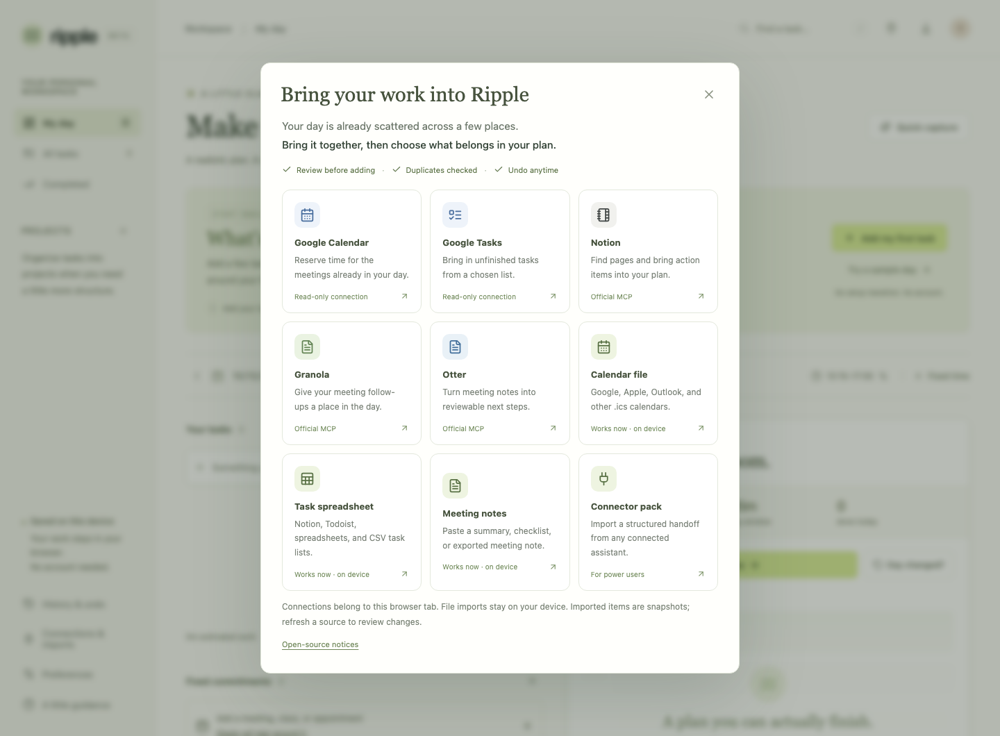

# Read-only imports and account connections

Ripple imports selected source content into a review screen. It never changes a calendar, task list, Notion page, or meeting note. Account connections created inside ChatGPT or Codex do not grant the Ripple web app access; connect separately in Ripple.

Google Calendar and Google Tasks use Google's browser OAuth flow. Notion, Granola, and Otter use the private Ripple backend described here. Files and pasted notes work without a provider account or backend. Imported notes remain untrusted text; their contents cannot select a tool, issue a network request, or override import rules.



## Enable the private backend

Set these server environment variables; restart the API after changing them:

```dotenv
# Exact public API origin, without a path or trailing slash.
# Local development may use http://127.0.0.1:8000 or http://localhost:8000.
RIPPLE_PUBLIC_API_URL=https://your-private-api.example
RIPPLE_ALLOWED_ORIGINS=https://your-account.github.io
RIPPLE_ACCESS_TOKEN=your-private-app-access-token
RIPPLE_CONNECTOR_SESSION_MINUTES=60
```

The public API origin is used for registered OAuth callback URLs. It must be HTTPS except for local development. Explicit CORS origins must match the actual website origin; the GitHub Pages repository path is not part of the origin. The backend must be reachable in the user's browser. Connector imports work in either Ripple demo or live mode and do not consume the Nebius model allowance or invoke an AI model.

Run one API worker. Connector state is process-local and intentionally temporary: a page reload loses the browser's in-memory session credential; server restart or the configured session expiry discards the matching provider credentials. Multiple API workers or replicas require a separate shared, encrypted session store before use. The default lifetime is 60 minutes, configurable from 5 to 120 minutes. Access tokens can expire earlier; reconnect rather than silently refreshing a long-lived grant. Closing the import panel keeps the connection for the current page; reloading the page does not.

## Connect Notion, Granola, or Otter

In Ripple, select the provider and choose Connect. The backend discovers the provider's official OAuth metadata and registers a public OAuth client for its callback. A popup opens the provider's consent screen. Sign in to your own provider account, review access, and authorize. The callback sends a one-time confirmation to the original Ripple window. That window confirms using its own separate session credential; only then does Ripple verify the provider's MCP read tools and display Connected.

If the browser severs the popup's opener, the callback displays a one-time completion code. Paste it into the original Ripple connection flow within five minutes. This code is not a provider access token. Do not share authorization URLs or completion codes. A denied or expired flow remains disconnected.

Search for a page or meeting, select a result, and load its text. Review the proposed action items before adding them to your local workspace. Disconnect discards that provider's local grant and result selection. To revoke the authorization at the provider itself, remove Ripple in that provider's account/integration settings; Ripple deliberately does not invoke write-like sign-out or workspace-changing tools.

| Provider | Official MCP endpoint | Authorized read tools used by Ripple | Practical limits |
| --- | --- | --- | --- |
| Notion | `https://mcp.notion.com/mcp` | Discovered `notion-search` / `notion-ai-search` / `search`, then `notion-fetch` / `fetch` | Workspace capabilities and search features vary by account. Interactive OAuth is required. |
| Granola | `https://mcp.granola.ai/mcp` | `list_meetings`, `get_meetings` | Search filters returned recent-note titles if the list tool has no query parameter. Older matches can be absent. No transcript, AI-query, sign-out, or workspace-switch tool is called. |
| Otter | `https://mcp.otter.ai/mcp` | `search`, `fetch` | Access depends on the user's meeting permissions and Otter MCP availability. A generic API key is not a substitute for MCP OAuth. |

All three currently advertise OAuth Dynamic Client Registration and PKCE S256. Metadata is discovered again when a new server process creates its first connection. Only these exact provider origins are allowed for metadata, registration, token exchange, and MCP requests. The client requests Notion's `default`, Granola's resource-advertised `mcp`, and Otter's `conversations:read` scope. Provider consent can authorize a broader collection than Ripple's read-only tool allowlist; read the consent screen. Runtime tool discovery is authoritative; an unfamiliar required parameter produces a clear compatibility error instead of an invented request.

Sources: [Notion MCP client implementation](https://developers.notion.com/guides/mcp/build-mcp-client), [Notion supported connection methods](https://developers.notion.com/guides/mcp/get-started-with-mcp), [Granola MCP](https://docs.granola.ai/help-center/sharing/integrations/mcp), [Otter MCP](https://help.otter.ai/hc/en-us/articles/35287607569687-Otter-MCP-Server).

## Optional Notion server-token fallback

An operator can use Notion's official REST API instead of OAuth for a private, single-organizer deployment:

1. Create an internal connection in Notion's developer portal. Give it **Read content** only; disable insert and update capabilities.
2. Share only the relevant Notion pages with that connection through the page's **Add connections** menu.
3. Put its token in the backend's secret store as `NOTION_API_TOKEN`. Also set `RIPPLE_ACCESS_TOKEN`; the fallback refuses to operate without this private app token.
4. Restart the API and connect Notion from Ripple. The UI identifies this as the server owner's shared workspace, rather than a separate personal OAuth account.

Never put the Notion token in a `VITE_` variable or a browser settings field. Every holder of the Ripple app access token can opt into this same shared Notion workspace; do not configure this fallback for an untrusted multi-user service. Leave `NOTION_API_TOKEN` unset to use personal Notion MCP OAuth instead.

The fallback uses API version `2026-03-11`, one `POST /v1/search` results page, and at most four `GET /v1/blocks/{id}/children` calls per selected page, to a maximum nesting depth of two. Checked and unchecked Notion to-do blocks retain `[x]` and `[ ]` markers. Omitted pages or nested blocks produce warnings. No database or page writes are made. [Notion authorization](https://developers.notion.com/guides/get-started/authorization), [search by title](https://developers.notion.com/reference/post-search), [read block children](https://developers.notion.com/reference/get-block-children).

## Google setup

Create a Google Cloud OAuth client of type **Web application**, enable Calendar API (and Tasks API if importing tasks), and add the website origin to Authorized JavaScript origins. Configure the OAuth consent screen and add permitted test users while the app remains in Testing. The Google client ID is public; a client secret does not belong in this browser flow. Review only the read scopes requested by the actual UI. Google Identity Services' token model returns a short-lived access token to the browser; keep it in memory and request a new grant when expired. Do not send it to Ripple's AI endpoints or write it into exports.

Relevant official references: [GIS browser token model](https://developers.google.com/identity/oauth2/web/guides/use-token-model), [Calendar scopes](https://developers.google.com/workspace/calendar/api/auth), [Google Tasks authorization](https://developers.google.com/workspace/tasks/auth).

Set the public Google OAuth client ID as `VITE_GOOGLE_CLIENT_ID` when building the frontend, or enter it in the import panel's advanced setup. Ripple requests `calendar.events.readonly` and `calendar.calendarlist.readonly` for calendar import, and `tasks.readonly` for Google Tasks, under `https://www.googleapis.com/auth/`. A Google client secret is neither required nor accepted by this browser flow. These Google connections also require a real user consent test; mock import tests do not establish production OAuth verification.

For this GitHub Pages deployment, use `https://aaravsinhaofficial.github.io` as an authorized origin (no `/ripple` path). Add `http://127.0.0.1:5173` and `http://localhost:5173` for local development. Set the repository's public Actions variable `GOOGLE_CLIENT_ID`; the Pages build maps it to `VITE_GOOGLE_CLIENT_ID`. Never put a client secret or access token in an Actions variable or frontend environment variable.

## File imports that work without an account

Open the plug icon, **Connections and imports**, then choose a source. Imports add selected items to the current workspace; restoring a workspace backup is a separate operation that replaces it.

- **Calendar file:** upload a `.ics` export and choose 1–31 dates in the workspace timezone. Recurring meetings are expanded within that window, including exceptions. All-day events are skipped by default; explicitly enable blocking if they should occupy the whole day. Canceled and free events are skipped. Calendar seconds are rounded outward. Events the daily wall-clock planner cannot represent across an ambiguous clock change are reported instead of silently shortened. Imports are limited to 200 event segments; a smaller window makes selection easier within the workspace's 50-commitment limit.
- **Task spreadsheet:** upload CSV and check the column mapping. Quotes, embedded newlines, comma/tab/semicolon delimiters and Todoist task rows are supported. Select an explicit date format for numeric dates. Missing durations use the displayed default estimate; invalid rows appear with reasons. Use a stable ID or source URL column for reliable updates. Without either, matching uses title and project, so renamed items look new.
- **Meeting notes:** paste or upload text/Markdown. Unchecked boxes, `TODO:`/`ACTION:` lines, and bullets beneath an action-items heading become drafts. Checked actions, ordinary prose and fenced code are not turned into new work. Relative deadline shortcuts use the selected Ripple planning date. These are explicit actions from the source, not AI-extracted promises; select only the work that belongs to you.

Files have a 1 MB limit; each batch supports at most 200 items. Source identities and fingerprints survive workspace backups and editor saves. Reuse the same **Import identity** for refreshed exports. Source changes are unchecked by default, show field differences and warn about local edits. Nothing is deleted by a refresh. Changing a source's identifier or importing a renamed item without a stable ID can create a new draft; review before adding.

An action can preserve a stable block ID in Markdown:

```markdown
## Action items
- [ ] Review the proposal 30m <!-- id:proposal-review -->
- [ ] Send the client update 15m due:tomorrow <!-- id:client-update -->
```

## Connector packs for other tools and assistants

Choose **Connector pack**, then upload or paste JSON. This is useful for a selected handoff from existing assistant connections, GitHub issues, Linear tasks or a custom script. The app does not borrow the assistant's credentials and does not fetch a supplied source URL.

```json
{
  "version": 1,
  "source": {"provider": "notion", "label": "Project follow-ups", "namespace": "stable-page-id"},
  "items": [
    {
      "kind": "task", "externalId": "stable-action-id", "title": "Review the proposal",
      "notes": "Keep feedback to the two open decisions.", "minutes": 30,
      "priority": "normal", "project": "Client work", "status": "todo",
      "dueDate": "2026-10-16", "url": "https://www.notion.so/example"
    },
    {
      "kind": "commitment", "externalId": "stable-event-instance-id", "title": "Project check-in",
      "notes": "Fixed meeting", "date": "2026-10-16", "start": 600, "end": 630
    }
  ],
  "skipped": [],
  "warnings": ["Task duration is an estimate to review."]
}
```

Dates are real `YYYY-MM-DD` dates. Commitment times are whole minutes from midnight in the Ripple workspace timezone, with exclusive end and one segment per date. Task estimates are 1–720 whole minutes. Priority is `high`, `normal` or `low`; status is `todo` or `done`. Each item needs a stable `externalId`, title and notes (which may be empty). Supported source providers are `ics`, `csv`, `notes`, `json`, `google-calendar`, `google-tasks`, `notion`, `todoist`, `granola`, `otter`, `github`, `linear` and `outlook`. Provider names identify provenance; they do not claim an active connection. Unknown fields, unsafe URLs, invalid dates and malformed records reject the pack before any workspace change.

Example instruction for an assistant that already has your accounts connected:

> Read only the notes or calendar range I select. Prepare a version 1 Ripple connector pack using the format above. Preserve stable source IDs and links. Include only my explicitly assigned unfinished actions and selected fixed meetings; do not guess ownership. Label estimated durations in warnings. Convert event times to my Ripple timezone and split overnight events by date. Exclude credentials and unrelated content. Return the pack for review; do not change any source account.

## Frontend API contract

Every route except the OAuth callback uses the normal Ripple `Authorization: Bearer ...` header when the private API requires it. No provider secret is accepted from the browser. Send the opaque browser session credential in `X-Ripple-Connector-Session` after creating it; retain it only in memory, not a URL, localStorage, sessionStorage, or an export.

| Route | Request | Response |
| --- | --- | --- |
| `POST /api/connectors/session` | No body required | `{sessionToken, expiresAt}` |
| `GET /api/connectors` | Optional session header | `{providers:[{id,label,configured,connected,authMode,detail}], expiresAt?}` |
| `POST /api/connectors/{provider}/connect` | Session header; browser Origin | `{connected:false,authorizationUrl,flowId,expiresAt}` or `{connected:true}` for the verified Notion server token |
| `POST /api/connectors/{provider}/finish` | `{flowId,completionToken}` and session header | `{connected:true}` after MCP initialization/tool verification |
| `POST /api/connectors/{provider}/search` | `{query:"",limit:10}` and session header | `{provider,documents:[{id,title,url?,excerpt?}],warnings:[]}` |
| `POST /api/connectors/{provider}/read` | `{id}` from this session's search and session header | `{provider,document:{id,title,url?,excerpt?,text},warnings:[]}` |
| `POST /api/connectors/{provider}/disconnect` | Session header | `{connected:false}` |

Providers are exactly `notion`, `granola`, or `otter`. Query length is at most 200 characters, results at most 20, document text at most 24,000 characters, and upstream responses at most 750 KB. Each operation has a 60-second overall time limit and no automatic retry. One browser grant keeps at most 100 selected-result references; older results may require a fresh search. The application's existing body and request-rate limits also apply to connector POST routes. There is no generic remote URL or tool execution endpoint.

The popup callback route is `GET /api/connectors/oauth/{provider}/callback`. On success it posts:

```json
{
  "type": "ripple-connector-complete",
  "provider": "notion",
  "flowId": "opaque-flow-id",
  "completionToken": "one-time-completion-code"
}
```

Before calling `/finish`, the frontend must check **both** `event.origin === new URL(apiBase).origin` and `event.source === thePopupOpenedForThisFlow`, then match the provider and flow ID. The backend checks the independent browser session, one-time state, PKCE verifier, expiry, and completion-code hash. Do not add provider tokens to callback messages. No cross-site cookies or credentialed CORS requests are needed. The callback suppresses referrers and scripts other than its nonce-protected confirmation script; reverse proxies must also avoid logging OAuth callback query parameters.

## Evidence and deployment boundary

Public OAuth discovery metadata and official documentation were checked on 2026-10-13. Unit tests use protocol fixtures for successful OAuth, MCP JSON/SSE reads, Notion REST reads, isolation, expiration, unsafe endpoints, malformed responses, and failure paths. No user's account was connected, no live document import was performed, and no paid model call was made during implementation. A successful real OAuth connection and selected-document import are still required to verify each provider against a specific account and its current permissions.

Run the local checks with:

```bash
.venv/bin/python -m pytest server/tests/test_connectors.py -q
```
